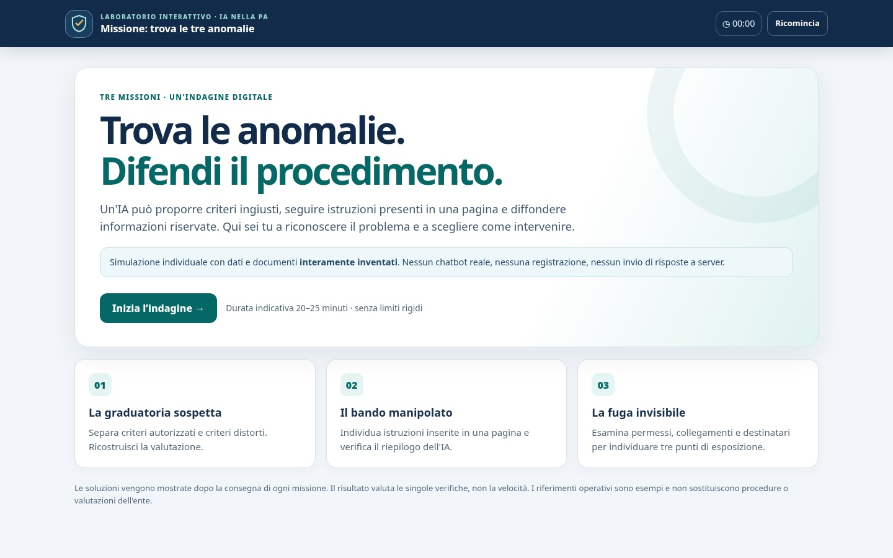

# Missione: trova le tre anomalie

Una web app interattiva e autonoma per riconoscere tre categorie di rischio nell'impiego dell'intelligenza artificiale in contesti amministrativi: **bias**, **prompt injection** e **data leakage**.

L'applicazione mette l'utente nei panni di chi deve esaminare informazioni, prendere decisioni motivate e distinguere i rischi da un normale flusso di lavoro. Non è necessario utilizzare un modello di IA reale.




Demo web su Github Pages:https://gigicogo.github.io/AI-Missione-trova-le-tre-anomalie/

## Che cosa contiene

Tre missioni progressive, con dati, pratiche e documenti interamente fittizi:

1. **La graduatoria sospetta — Bias.** Confronto tra criteri approvati e criteri introdotti impropriamente da una proposta automatizzata; ricostruzione di una graduatoria e scelta degli interventi opportuni.
2. **Il bando manipolato — Prompt injection.** Individuazione di istruzioni non attendibili in una pagina da riassumere; verifica delle affermazioni generate e delle misure da adottare.
3. **La fuga invisibile — Data leakage.** Analisi di un registro eventi e di una scheda dei permessi per identificare esposizioni in ingresso, nel recupero delle informazioni e in uscita.

Ogni missione comprende un fascicolo consultabile, attività interattive, una motivazione scritta e un **debrief commentato** sbloccato solo dopo la consegna. Al termine è possibile visualizzare il riepilogo e scaricare un rapporto di testo sul proprio dispositivo.

**Durata indicativa:** 20–25 minuti, variabile a seconda dell'esperienza e del grado di approfondimento. Non esiste una scadenza automatica.

## Provala subito

1. Scarica `index.html`.
2. Aprilo con un browser recente (Chrome, Edge, Firefox o Safari).
3. Seleziona **Inizia l'indagine** e completa le tre missioni.

Non serve installare nulla, creare un account o collegarsi a un servizio esterno. L'app funziona anche senza connessione Internet.

## Funzionalità

- HTML, CSS e JavaScript raccolti in **un unico file**.
- Nessuna dipendenza da librerie, API o CDN.
- Interfaccia adattiva per desktop, tablet e smartphone.
- Navigazione progressiva e spiegazioni disponibili dopo la consegna.
- Contatore del tempo trascorso, senza penalizzazioni per la lentezza.
- Salvataggio del progresso nel `localStorage` del browser, quando disponibile.
- Pulsante **Ricomincia** per cancellare le risposte locali.
- Esportazione di un rapporto `.txt` e stampa del riepilogo.
- Comandi accessibili da tastiera, con etichette e stati espliciti.

## Dati e privacy

L'applicazione è **statica**: non prevede server applicativi, autenticazione, tracker, invio di risposte o chiamate verso servizi esterni. Le scelte e le note vengono salvate esclusivamente nel browser dell'utente mediante `localStorage`, quando disponibile. Se il browser blocca questa funzione, l'app resta comunque utilizzabile per la sessione aperta.

Le note eventualmente inserite vengono aggiunte solo al file di rapporto scaricato dall'utente. È preferibile non inserire nomi, documenti o informazioni reali nelle note.

Come per qualsiasi sito ospitato da terzi, il servizio di hosting (ad esempio GitHub Pages) può gestire i normali log tecnici delle richieste HTTP; questo non comporta l'invio delle risposte dell'applicazione.

## Personalizzazione

Apri `index.html` con un editor di testo.

- I testi, i casi e le soluzioni sono definiti nello script nell'oggetto `taskData` e nelle funzioni `sourceBias`, `sourceInjection`, `sourceLeakage`.
- Colori e impaginazione si modificano nella sezione `<style>` attraverso le variabili CSS `:root`.
- Titolo, descrizione e indicazioni di durata possono essere aggiornati direttamente nel markup e nelle funzioni di rendering.

Se modifichi i casi, aggiorna **anche le risposte attese e le spiegazioni** utilizzate per il feedback. Per la graduatoria della prima missione, controlla che i punteggi della griglia producano esattamente l'ordine atteso.

## Uso responsabile e limiti

Tutti gli scenari sono inventati e servono esclusivamente a sviluppare capacità di analisi. I punteggi hanno valore didattico: non sono una certificazione di competenza, un audit di sicurezza o un giudizio su persone reali. I comportamenti simulati non sostituiscono procedure, autorizzazioni, indicazioni dei referenti competenti o valutazioni giuridiche.

## Struttura del progetto

```text
missione-tre-anomalie/
├── index.html
└── README.MD
```

Nessun processo di build è necessario.

📄 Licenza

Da definire: si suggerisce una licenza aperta (es. MIT o CC BY 4.0) per favorire il riuso da parte di altri formatori o altri enti. Sostituisci questo paragrafo con il testo della licenza scelta e il file LICENSE del repo.

👤 Autore e contesto

Gianluigi Cogo Content creator e technical writer interessato ad AI generativa, automazioni, viaggi e strumenti digitali. Consulente e docente sui temi dell'IA generativa nella Pubblica Amministrazione.

L'app nasce come esercitazione nel percorso operativo "L'IA nella Pubblica Amministrazione — Percorso operativo per l'uso consapevole, sicuro e governato dell'IA generativa" (20 ore: percorso base per funzionari ed esecutori + modulo governance per direttori e dirigenti). Per info sul corso contattatemi usando i social qui sotto.

📮 Newsletter: gigicogo.substack.com

📝 Blog: medium.com/webeconoscenza

▶️ YouTube: youtube.com/@gigicogo

💼 LinkedIn: linkedin.com/in/gigicogo
